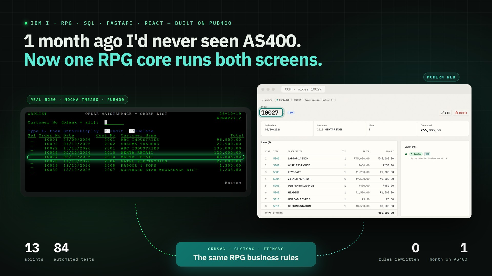
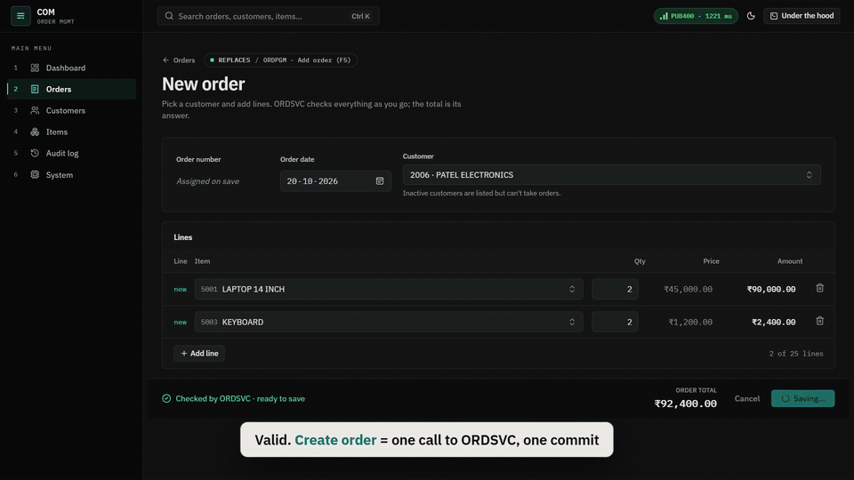
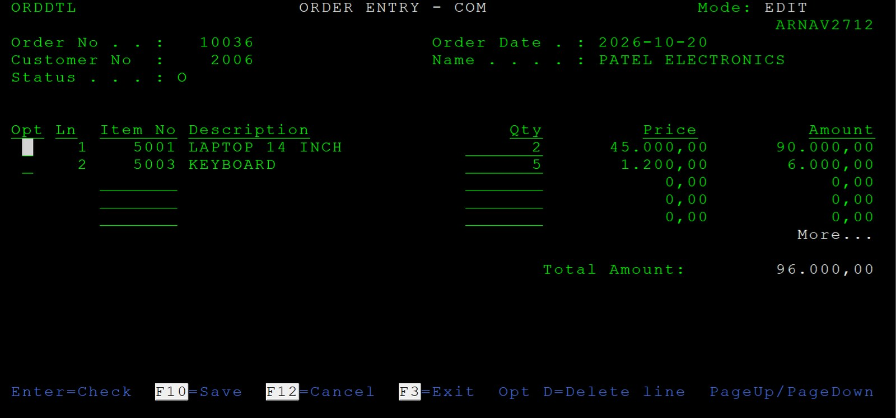
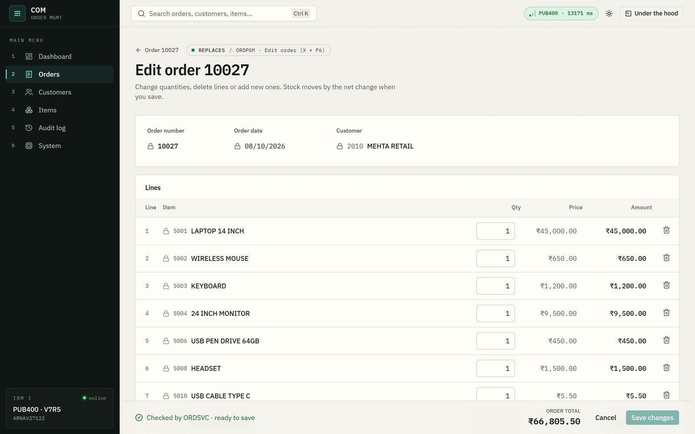
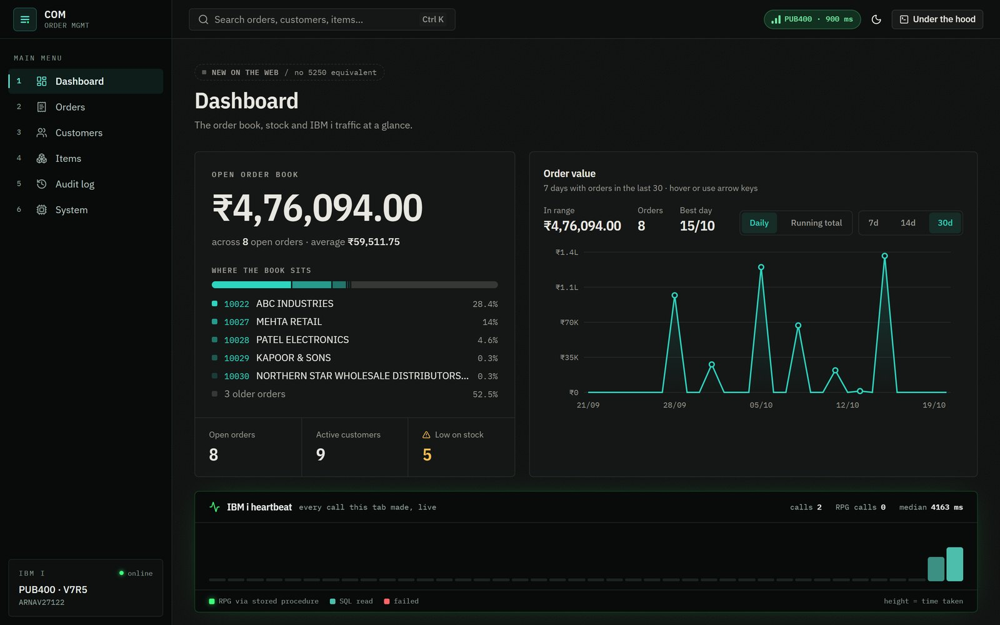
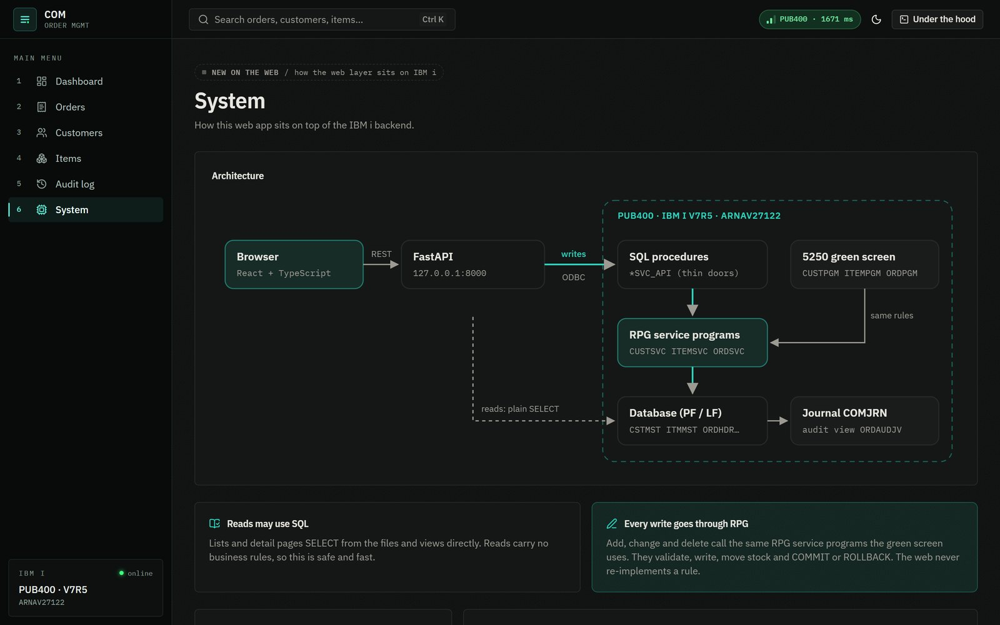
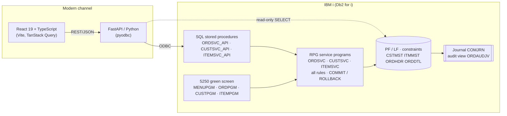

<div align="center">

# AS/400 Order Management + Modernization

**A complete IBM i (AS/400) order-entry system in RPG IV, then modernized for the web without rewriting its business rules.**



**[▶ Watch the 1-minute demo](docs/media/demo-1min.mp4)** · a real order on PUB400: created on the web (the RPG flags a bad quantity on the exact line), changed on the **real 5250 green screen**, and back on the web the audit trail says `U · 5250`



| 13 sprints | 84 automated tests | 0 business rules rewritten | 2 channels, 1 RPG core |
|:---:|:---:|:---:|:---:|


</div>

---

## What this is

**COM (Customer Order Management)** is the kind of system thousands of companies still run on IBM i: green-screen maintenance of customers, items and orders, written in RPG IV over Db2 for i.

This repository builds one **from the database up**, the way it's done on real IBM i shops. Then it does what clients actually pay for: **it modernizes the system without rewriting it.**

> **The one principle:** reads may use SQL; **every write goes through RPG.**
> The business rules live in one place, IBM i, and both the 5250 green screen and the web call the *same* RPG code.

It runs on **PUB400** (a public IBM i, V7R5) as two separate libraries, one per flow:

| Library | Flow | What it contains |
|---|---|---|
| `ARNAV27121` | **Green screen** (tag [`greenscreen-v2`](../../tree/greenscreen-v2)) | Sprints 1–7: the classic 5250 application, unchanged |
| `ARNAV27122` | **Modern** (`main`) | The same system after a *strangler refactor*: rules in service programs, called by the 5250 screens **and** by stored procedures for the web |

---

## See it

| The real 5250 (Mocha TN5250 on PUB400): the web's order, edited with the same RPG | Order editor: the RPG checks every line |
|---|---|
|  |  |
| **Dashboard (dark mode)** | **How the web sits on IBM i** |
|  |  |

---

## Architecture



**One order, two channels:** an order created in the browser appears immediately in the 5250 order list. Stock drops, and the audit log records **A · WEB**. Change it on the green screen, and the audit shows **U · 5250**.

---

## What I built, sprint by sprint

| Sprint | Delivered | Key techniques |
|---|---|---|
| **1. Database** | 5 physical files, 3 logical files, 24 SQL constraints (PK / CHECK / FK RESTRICT), a view, an index, a message file with 40+ messages, sample data loader | DDS, packed keys, `RUNSQLSTM` re-runnable scripts, embedded SQL (`SQLRPGLE`) |
| **2. Menu + customers** | Menu, customer list/detail with Add / Edit / Delete / Display | Load-all subfile, message subfile, ILE **service program** `COMUTIL` with binder source, binding directory, named activation group |
| **3. Items** | Item maintenance (sub-procedures, compared side by side with Sprint 2's subroutines), SQL price-change trigger | Prototypes, `/COPY`, **signature** management with `*CURRENT` / `*PRV` exports |
| **4. Orders (read)** | Order list, customer search, order display; SQL inquiry screen | Two subfiles in one display file, system paging, **SQL cursor** with host variables, **SQL stored procedure** called from RPG |
| **5. Create order** | Header + up to 25 lines, full validation, stock check | Data-area numbering under `*LOCK`, per-row subfile indicators, validate-before-write |
| **6. Edit / delete + transactions** | Edit (change / delete / add lines), delete with confirmation | **Journaling**, **commitment control** (`STRCMTCTL *CHG *JOB`), `COMMIT` / `ROLBK`, record locks, net stock change |
| **7. Audit, report, quality** | RPG audit trigger, order summary report, debugging exercises, full test checklist | Trigger buffer (old/new images via pointers), printer file + overflow, **batch** (`SBMJOB`, spooled files), journal-based audit |
| **8. Modernization layer** | `ORDSVC` / `CUSTSVC` / `ITEMSVC` (no screens), green-screen refactor, two-layer stored procedures, stale-edit protection | Separating logic from presentation, fixed parameter interfaces, external + SQL PL procedures, ODBC end-to-end test |
| **9–10. REST API** | FastAPI service for customers, items, orders, audit and dashboard; every write calls the RPG through the stored procedures; COM messages come back with their field and order line | Python 3.12, FastAPI, pydantic v2, pyodbc (direct, or through an SSH tunnel), fixed-width zoned buffers, connection pool, request trace header, pytest against the real IBM i |
| **11–13. Web frontend** | Dashboard (interactive order-value chart, live IBM i heartbeat), customers, items, order editor with live RPG validation, a **5250 twin** that redraws live data in the original DDS layout, order peek, audit timeline, command palette, "Under the hood" request waterfall | React 19, TypeScript strict, Tailwind v4, shadcn/ui, TanStack Query + Table, Recharts, Vitest, Playwright + axe |

---

## IBM i skills demonstrated

<table>
<tr><td valign="top" width="50%">

**RPG IV & ILE**
- Mixed-format RPG IV (fixed H/F/D/P specs, free-form logic)
- Subroutines *and* sub-procedures, prototypes, `/COPY`
- NOMAIN module → `*SRVPGM`, binder source, signatures
- Binding directories, named vs `*CALLER` activation groups
- Subfiles (load-all, paging, per-row indicators), message subfiles
- Native record I/O: `CHAIN` / `SETLL` / `READE`, `(N)` vs locking reads, `%FIELDS`
- Data areas with `*LOCK`, trigger programs, printer files

</td><td valign="top" width="50%">

**Db2 for i & system**
- DDS physical / logical files, keyed access paths
- SQL constraints proven by trying to break them (18 violation tests)
- Views, indexes, cursors, SQL PL stored procedures
- Journals, receivers, `IMAGES(*BOTH)`, `QSYS2.DISPLAY_JOURNAL`
- Commitment control across programs and activation groups
- CL programs, `MONMSG`, message files, `QMHSNDPM`
- Batch jobs, job queues, routing, spooled files, job logs

</td></tr>
</table>

## Modernization skills demonstrated

- **Strangler refactor:** business logic extracted from screen programs into callable service programs; the green screen was refactored to use them, so **both channels share one set of rules**.
- **Clean interfaces:** fixed-length parameter buffers (25 × 88-byte lines, 30 × 60-byte errors) with zoned numbers that RPG and Python both slice exactly. Every error carries its message ID, line and field, so the UI highlights the exact field.
- **Two-layer stored procedures:** an external procedure points at the RPG program; an SQL PL wrapper returns one result-set row, because pyodbc can't read OUT parameters.
- **Transactions across ODBC:** the RPG owns `COMMIT` / `ROLLBACK` inside the ODBC connection's transaction. Proved with a forced-failure switch: a failed save leaves **no order, no stock change and no audit row**.
- **Stale-edit protection:** an order fingerprint returned on load and checked on save (`COM0039`), so two people editing the same order can't overwrite each other.
- **Record locks:** a row locked by another job returns `COM0038` immediately instead of hanging the web request.
- **Audit without triggers:** where the platform forbids triggers, the audit trail (A/U/D, WEB vs 5250) is derived from the journal, with rolled-back work hidden.

---

## Verified, not just written

Every piece was compiled and exercised on a real IBM i:

| Check | Result |
|---|---|
| ODBC spike `tools/spike_svc.py` (web → stored procedure → RPG) | **31 / 31 pass**: validation, save, forced-failure rollback, stale edit, net stock change, delete, audit A/U/D from WEB, customer and item CRUD, delete blocking, record locks |
| SQL constraints | 18 deliberate violations, all refused (check, duplicate, FK insert, RESTRICT delete) |
| Commit / rollback | Journal shows `SC … CM` for good saves and `SC … DR … RB` for rolled-back ones |
| Batch report | `SBMJOB` → spooled file read back and checked |
| REST API | 23 unit tests + **11 integration tests against PUB400**: CRUD, line/field error mapping, create → edit → stale edit (COM0039) → delete with exact stock, forced rollback leaves nothing, a locked row answers COM0038 instead of hanging, audit A/U/D from WEB |
| Frontend | 50 Vitest tests; every screen checked in Edge against real PUB400 data; an order edit saved through the UI moved stock by the net change; 0 axe violations on 13 screens × 2 themes |

### Real bugs found and fixed along the way

These are the war stories that make IBM i work interesting:

- **RPG names ignore case:** a local variable `LineNo` silently *hid* the file field `LINENO`, so every new order line was refused by `CHECK LINENO > 0`. It was found by reading file status `01022` back through the error buffer.
- **SQL procedures run at their own commit level:** a procedure created with `COMMIT(*NONE)` can't call RPG that opens files under commitment control (`CPF4326`). Fixed with `SET OPTION COMMIT = *CHG`.
- **The library list decides everything:** over ODBC, the job's current library was a *different* library, so the right program opened the wrong files. Every web procedure now sets its own current library, just as the 5250 entry program does.
- **Even a no-lock read waits under commitment control:** a row being changed by another job blocked a read, and without `(E)` the program stopped on an inquiry message. Now it returns a clean "being changed by another user".
- **Decimal comma:** on a system with decimal-comma formatting, `DECIMAL(7,0)` in an SQL script is read as the number *7.0*.

---

## Built with AI: how I work with Claude Code

This project was built **pair-programming with an AI agent (Claude Code)**, with me as the engineer in charge. It's a deliberate showcase of using AI *well* on a legacy platform:

- **Plan, then "go":** for every sprint the agent proposed exactly which objects, members and commands it would create, and nothing was built until I approved. Design decisions were recorded with IDs (D1–D11, A1–A13, E1–E7, S1–S4) so they're never re-litigated.
- **A project brain:** a `CLAUDE.md` file held the rules, the current status and a session log, and the agent kept persistent notes, so every new session picked up exactly where the last one stopped. (Both stay in my private working copy.)
- **Verification over confidence:** nothing counted as done until it ran on IBM i. Compiles were checked through listings and job logs, data through SQL, and the web path through an end-to-end ODBC spike. When a claim was wrong, the evidence said so and it was fixed.
- **Safety rails:** test objects are always `ZZ*` and deleted afterwards; credentials live only in a git-ignored `.env`; nothing existing is deleted or renamed without my OK; the exam-ready baseline is frozen in its own library and git tag.
- **Learning by building:** every sprint ends with a walkthrough (concepts, viva questions, a hands-on test path) and mistakes become short lessons ([`docs/lessons/`](docs/lessons)).

**What that let me do:** build a full RPG application plus a web modernization in under two weeks, while understanding every line well enough to defend it.

---

## Repository map

```
ibmi/                    IBM i sources (local master copies, pushed with CPYFRMSTMF)
  qddssrc/                 PF, LF, display files, printer file (DDS)
  qrpglesrc/               RPG IV programs, service programs, COMUTIL module, prototypes
  qclsrc/                  CL: entry point, journal set-up, message file, trigger set-up
  qsqlsrc/                 SQL: constraints, views, procedures, audit view, practice queries
  qsrvsrc/                 binder source for COMUTIL
api/                     FastAPI REST service: the web's door into the RPG (see api/README.md)
web/                     React + TypeScript frontend
tools/                   ODBC tunnel + end-to-end spike for the service layer
docs/                    test checklist, debugging scripts, demo script, audit design, lessons
```

---

## Run it yourself

**On IBM i** (any V7R4+ system; built and tested on PUB400):

1. Create a library and the source files `QDDSSRC`, `QRPGLESRC`, `QCLSRC`, `QSRVSRC`, `QSQLSRC` (`RCDLEN(112)`).
2. Copy the members from `ibmi/`. The sources say `COM022LIB`; replace that with your library name.
3. Build in dependency order: PFs → LFs → `COMCST` / `COMDDL1` → `NXTORDNO` + `CRTCOMMSG` → `LOADDATA` → `COMUTIL` (module, service program, binding directory) → display files → programs → `SETUPJRN` → `PROCS`.
4. Start the app: `CALL yourlib/COMSTART`.

**Service layer from Python:**

```sh
sh tools/tunnel_pub400.sh          # optional SSH tunnel; skip it when PUB400_DIRECT is set in .env
python tools/spike_svc.py          # needs PUB400_USER / PUB400_PASS in .env
```

**API + frontend:**

```sh
sh tools/tunnel_pub400.sh                                   # optional (not needed with PUB400_DIRECT)
cd api && python -m venv .venv && .venv/Scripts/pip install -e ".[dev]"
.venv/Scripts/uvicorn app.main:app --port 8000              # http://127.0.0.1:8000/docs
cd web && npm install && npm run dev                        # http://localhost:5173
```

A walk-through for showing it to someone: [`docs/demo-script.md`](docs/demo-script.md).

---

## Status & roadmap

- [x] Sprints 1–7: the green-screen application
- [x] Sprint 8: service layer, green-screen refactor, stored procedures, ODBC proof
- [x] Sprints 9–10: FastAPI between the frontend and the stored procedures, tested against IBM i
- [x] Sprints 11–13: web frontend, built first on a contract mock, now on the real API (mock removed)
- [ ] Next: JSON export, object authority

---

<div align="center">

**Arnav Gupta** · IBM i / RPG developer with a modernization mindset

*Built on IBM i, end to end: from DDS and RPG to a React UI.*

</div>
